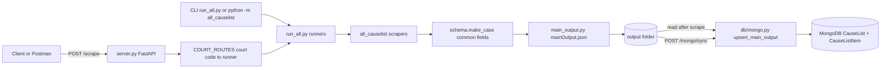
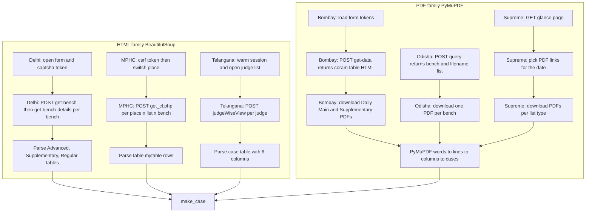
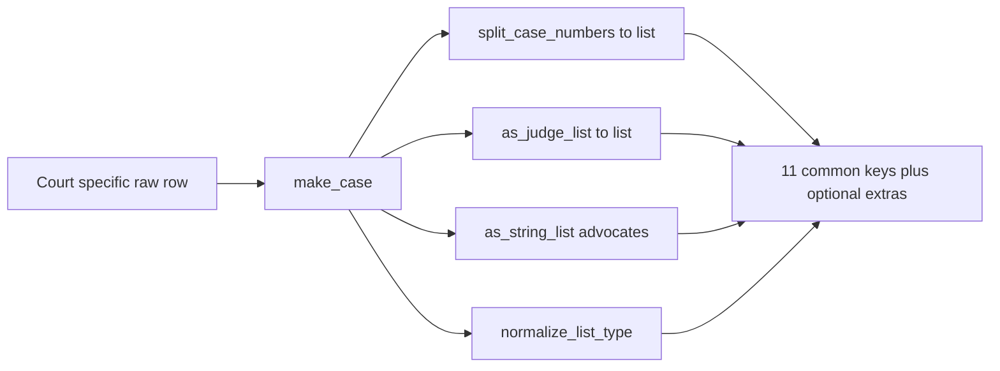
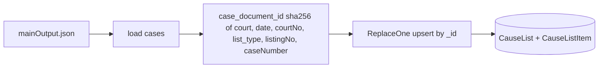
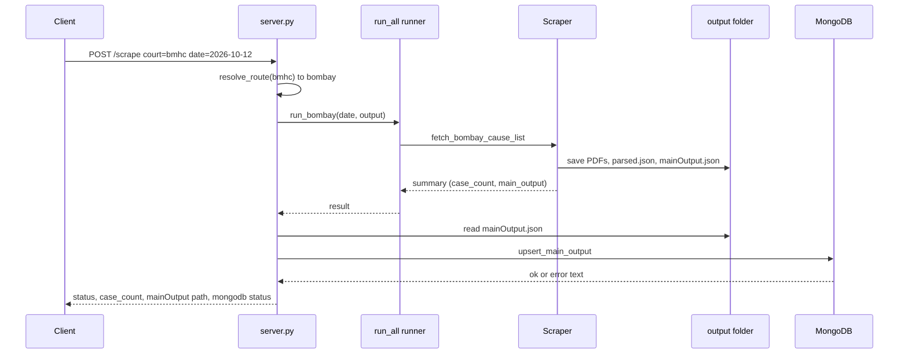
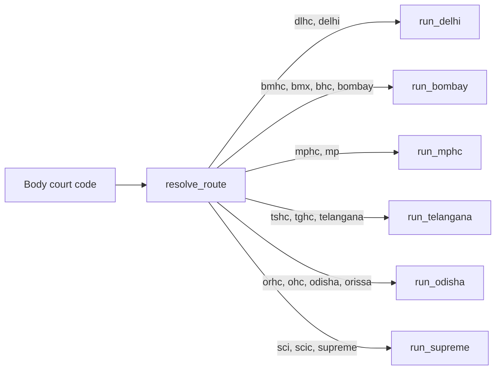

# Cause List Scrapers: Architecture

This project scrapes daily cause lists from 6 courts, writes a Legixo-shaped `mainOutput.json` per court (`CauseList` documents + `CauseListItem` rows), and upserts into MongoDB collections `causelists` and `causelistitems`.

Courts covered: Delhi HC, Bombay HC, Madhya Pradesh HC, Telangana HC, Orissa HC, Supreme Court of India.

## 1. Big picture



In words:

1. A request arrives with a court code such as `bmhc` or `sci`.
2. `server.py` resolves the code to a runner in `run_all.py`.
3. The runner calls the court scraper in `all_causelist/`.
4. The scraper builds every case with `make_case()` so all courts share the same fields.
5. `main_output.py` writes Legixo-shaped `mainOutput.json` (`documents[]` with nested `items[]`).
6. `db/mongo.py` upserts `CauseList` parents then `CauseListItem` children. A Mongo failure never fails the scrape. PDF URI lives on the parent as `rawRef` (set after GCS upload in cloud).

GCS PDF layout (all courts, folder-wise):

```text
gs://BUCKET/causelist/<courtKey>/<hearingDate>/<listType>/<file>.pdf
```

Example: `gs://legixo-docs-dev/causelist/bmhc/2026-10-12/main/coram-01.pdf`

## 2. Folder structure

```text
causelists/
  server.py                 HTTP API (scrape, mongo sync, read mainOutput)
  run_all.py                Run one or all scrapers from the command line
  db/
    mongo.py                Upsert CauseList + CauseListItem (Legixo)
  .env.example              MONGO_URI, MONGO_DB
  pyproject.toml            Dependencies (httpx, bs4, pymupdf, fastapi, pymongo)
  all_causelist/
    all_schemas/
      schema.py             Legixo CauseList / CauseListItem builders + enums
      sc_schema_map.py      Supreme Court schema map (re-exports supreme_schema.py)
    main_output.py          Builds Legixo-shaped mainOutput.json
    delhi.py                Delhi scraper (HTML)
    telangana.py            Telangana scraper (HTML)
    mphc.py                 Madhya Pradesh scraper (HTML)
    bombay.py               Bombay scraper (PDF)
    odisha.py               Odisha scraper (PDF)
    supreme.py              Supreme Court scraper (PDF)
    supreme_schema.py       Maps Supreme Court layout rows to the common schema
    pdfLayout/
      bombay_pdf_layout.py  PyMuPDF column parser for Bombay
      odisha_pdf_layout.py  PyMuPDF column parser for Odisha
      supreme_pdf_layout.py PyMuPDF column parser for Supreme Court
  output/                   All generated data (single output location)
```

## 3. How each court is scraped

| Court | Code(s) | Source type | Where the data comes from |
|---|---|---|---|
| Delhi HC | `dlhc`, `delhi` | HTML (server-rendered pages) | `delhihighcourt.nic.in/app/online-causelist` |
| Madhya Pradesh HC | `mphc`, `mp` | HTML (AJAX response body) | `portal.mphc.gov.in/php/hc/causelist/get_cl.php` |
| Telangana HC | `tshc`, `tghc`, `telangana` | HTML (judge wise pages) | `causelist.tshc.gov.in/judgeWiseView` |
| Bombay HC | `bmhc`, `bmx`, `bhc`, `bombay` | PDF (HTML index lists PDF links) | `bombayhighcourt.gov.in/bhc/causelistFinal` |
| Orissa HC | `orhc`, `ohc`, `odisha`, `orissa` | PDF (eCourts index returns filenames) | `hcservices.ecourts.gov.in` highcourt_causelist |
| Supreme Court | `sci`, `scic`, `supreme` | PDF (glance page lists PDF links) | `sci.gov.in/cause-list/` |

Two families:

- **HTML family** (Delhi, MPHC, Telangana): read the HTML body and parse table rows with BeautifulSoup.
- **PDF family** (Bombay, Odisha, Supreme): download PDFs, then read word positions with PyMuPDF and split them into columns by page width.



### 3.1 Delhi High Court (HTML)

Flow:

1. GET the cause-list page, read the CSRF token and the captcha code from the form.
2. POST `validateCaptcha` with that code. The site shows the code in the page, so the scraper reuses it.
3. POST `get-bench` for the date to get the dropdown of courts (benches).
4. For each bench, POST `get-bench-details` and parse three tables: Advanced List, Supplementary List, Regular List.

Table columns used:

| HTML column | Raw field |
|---|---|
| 1 | `item_no` |
| 2 | `case_no` (plus a `case_history_url` link) |
| 3 | `case_title` |
| 4 | `advocate` |
| 5 | `case_stage` |
| 6 | `remarks` |

Mapping to common fields:

| Common field | Taken from |
|---|---|
| `courtNo` | bench court number |
| `listingNo` | `item_no` |
| `caseNumber` | `case_no` |
| `party` | `case_title` |
| `judge` | bench judge name |
| `list_type` | table heading |
| `section` | `case_stage` |
| `remark` | `remarks` |
| `advocates` | `advocate` |

Extras kept only in the raw JSON: `item_no`, `case_no`, `case_title`, `advocate`, `case_stage`, `remarks`, `case_history_url`, `side`, and optionally `cnr`.

### 3.2 Madhya Pradesh High Court (HTML)

Flow:

1. GET the portal page and read `csrf_token`.
2. Switch bench place with `session_my.php` (Jabalpur 01, Indore 02, Gwalior 03).
3. POST `get_cl.php` for every combination of place, list type (Motion, Final, Lok Adalat, Mediation) and bench size (Single, Division, Full).
4. The response body is HTML. Parse each `table.mytable`.

Parsing rules:

- The judge name is the nearest heading above the table.
- A heading row such as `MOTION HEARING` sets the `section`.
- A row whose first cell is a number starts a new case.
- A row containing `Vs.` fills the respondent and respondent advocates.
- Other rows are stored as notes.

Mapping to common fields:

| Common field | Taken from |
|---|---|
| `courtName` | `High Court of Madhya Pradesh (<place>)` |
| `courtNo` | place code 01, 02 or 03 |
| `listingNo` | `item_no` |
| `caseNumber` | `case_no` |
| `party` | `petitioner VS respondent` |
| `judge` | judge heading |
| `list_type` | list type (Motion, Final, Lok Adalat, Mediation) |
| `section` | heading row |
| `remark` | `remarks` |
| `advocates` | petitioner and respondent advocates |

Extras only in raw JSON: `place`, `mfb`, `sbdb`, `case_url`, `petitioner`, `respondent`, `vc_link`, `notes`.

### 3.3 Telangana High Court (HTML)

Flow:

1. GET the home page and the daily cause list page to warm the session.
2. POST `judgeCauseList` for the date to get the judge dropdown.
3. For each judge, POST `judgeWiseView` and parse the case tables.

Parsing rules:

- A table is a case table when its headers include `Sl.No.`, `Case` and `Party Details`.
- Single-cell rows carry the court number, list name, timing, or a section heading.
- Case rows have 6 columns: item no, case no, party details, petitioner advocate, respondent advocate, district or remarks.

Mapping to common fields:

| Common field | Taken from |
|---|---|
| `courtNo` | `COURT NO` text above the table |
| `listingNo` | item no |
| `caseNumber` | case no |
| `party` | party details |
| `judge` | selected judge |
| `list_type` | list heading (Daily, Supplementary, Weekly) |
| `section` | section row |
| `remark` | district or remarks |
| `advocates` | petitioner advocate and respondent advocate |

Extras only in raw JSON: `bench_heading`, `timing`, `list_name`, `petitioner_advocate`, `respondent_advocate`.

### 3.4 Bombay High Court (PDF)

Flow:

1. GET the `causelistFinal` page and read the hidden form tokens.
2. POST `causelist/get-data` for the date. The JSON reply contains an HTML table of corams (benches) and links to PDFs.
3. Keep only Daily Main and Daily Supplementary links by default. `--all-types` adds weekly, chamber, production and officer lists.
4. Download each PDF into `pdfs/<coram>/`.
5. Parse each PDF with PyMuPDF (`bombay_pdf_layout.py`).

PDF column layout (fractions of page width): serial `0 to 0.11`, case number `0.11 to 0.32`, parties `0.32 to 0.62`, advocates `0.62 to 1.0`.

What the parser reads:

- Headers: `COURT NO`, `DIVISION` or `SINGLE` bench, `HON'BLE` judge lines, `AT hh:mm` session time.
- Section lines such as `FOR FINAL HEARING`, `FOR ORDERS`, `PART HEARD`.
- Each case starts at a serial number plus a case id such as `WP/123/2024`.
- `V/S` splits the two parties. `REMARK:` lines become the remark.

Mapping to common fields:

| Common field | Taken from |
|---|---|
| `courtNo` | `COURT NO` header |
| `listingNo` | serial column |
| `caseNumber` | case column (list, includes connected cases) |
| `party` | party column joined with `VS` |
| `judge` | judge lines |
| `list_type` | PDF link text, normalized |
| `section` | section header |
| `remark` | `REMARK:` text |
| `advocates` | advocate column |

Extras only in `parsed.json`: `coram`, `bench`, `session_time`, `page`, `source_list`.

### 3.5 Orissa High Court (PDF)

Flow:

1. GET the eCourts page to warm the session.
2. POST `highcourt_causelist_qry.php` with `pulishedCauselist` and the date. The reply is plain text: records separated by `^#`, fields separated by `~` (serial, bench, list type, date, filename).
3. Download each PDF from `display_causelist.php?filename=...`.
4. Parse each PDF with PyMuPDF (`odisha_pdf_layout.py`).

PDF column layout: left `0 to 0.375` (serial, case id, CNR), middle `0.375 to 0.66` (parties), right `0.66 to 1.0` (advocates).

What the parser reads:

- Court header (`COURT NO` or `CHIEF JUSTICE'S COURT`), judge lines, session time.
- Section lines such as `FOR ORDERS`, `FRESH ADMISSION`, `STAYED MATTERS`.
- Each case starts with `<serial>) <case id>`.
- CNR is read from `[ODHC...]`. `WITH <case id>` lines become connected cases.

Mapping to common fields follows the same pattern as Bombay.

Extras only in `parsed.json`: `cnr`, `bench`, `session_time`, `page`, `source_list`, `pdf_path`.

### 3.6 Supreme Court of India (PDF)

Flow:

1. GET `sci.gov.in/cause-list/` (Cause Lists at a Glance).
2. Pick PDF links that belong to the date. File name codes map to list types: `J` miscellaneous, `C` chamber, `S` single judge, `R` registrar. Advance lists are detected from the URL.
3. Download each PDF into `pdfs/<list_type>/<main|supplementary>.pdf`.
4. Parse each PDF with PyMuPDF (`supreme_pdf_layout.py`).

PDF column layout: left `0 to 0.30` (serial, case number, category), middle `0.30 to 0.70` (petitioner, Versus, respondent, IA notes), right `0.70 to 1.0` (advocates).

What the parser reads:

- Court header (`COURT NO. n`, `CHIEF JUSTICE'S COURT`, registrar court), `HON'BLE` judge lines.
- Section headings (hearing, admission, orders).
- Advocate entries such as `NAME - 1234 [P-1]` are split into petitioner and respondent advocates.
- IA lines (`IA No. ... - type`) become applications.

Mapping to common fields (`supreme_schema.py`):

| Common field | Taken from |
|---|---|
| `courtNo` | court label (`CJ` for Chief Justice, otherwise the number) |
| `listingNo` | serial number |
| `caseNumber` | case number (single item list) |
| `party` | `petitioner VS respondent` |
| `judge` | judge lines |
| `list_type` | folder tag mapped to a label (for example `MISCELLANEOUS LIST`) |
| `section` | section heading |
| `remark` | IA applications and `Mention Memo` |
| `advocates` | petitioner advocates followed by respondent advocates |

Supreme Court is the only court that keeps extras inside `mainOutput.json`: `petitioner`, `respondent`, `petitioner_advocates`, `respondent_advocates`, `case_category`, `applications`, `source_list`, `page`.

## 4. The common case schema

Canonical output is Legixo parent/child (defined in `all_schemas/schema.py`):

**CauseList (parent):** `source`, `courtLevel`, `courtKey`, `hearingDate`, `listType`, `benchLabel`, `checksum`, `status`, `externalId`, optional `rawRef` / `contentType`.

**CauseListItem (child):** `hearingDate`, `fingerprint`, `identities`, optional `listingNo` (number), `listingSection`, `courtNo`, `bench`, `judges`, `party`, `payload` (holds `advocates`, `remark`, `courtName`, display list type, SCI extras).

Scrapers still build flat intermediate rows via `make_case()`; `main_output.py` groups them into documents. Legacy flat 11-key rows (for reference only):

| Field | Type | Meaning |
|---|---|---|
| `date` | string | Cause-list date, `YYYY-MM-DD` |
| `courtName` | string | Display name of the court |
| `courtNo` | string or null | Court room or seat code |
| `listingNo` | string or null | Serial or item number on the list |
| `caseNumber` | list of strings | Main case plus connected cases |
| `party` | string or null | Parties, usually `A VS B` |
| `judge` | list of strings | Bench judges |
| `list_type` | string | Normalized label such as `DAILY LIST` |
| `section` | string or null | Heading the case is listed under |
| `remark` | string or null | Remarks or notes |
| `advocates` | list of strings | All counsel (may be empty) |

`normalize_list_type()` maps court-specific labels (`daily main`, `supplimentary`, `lok_adalat`, `single_judge`, and so on) to one vocabulary.



## 5. What `mainOutput.json` contains

Shape:

```json
{
  "date": "2026-10-12",
  "court": "bombay",
  "courtName": "Bombay High Court",
  "case_count": 2043,
  "cases": [
    {
      "date": "2026-10-12",
      "courtName": "Bombay High Court",
      "courtNo": "7",
      "listingNo": "12",
      "caseNumber": ["WP/123/2024"],
      "party": "A VS B",
      "judge": ["HON'BLE ..."],
      "list_type": "DAILY LIST",
      "section": "FOR FINAL HEARING",
      "remark": null,
      "advocates": ["Adv X", "Adv Y"]
    }
  ]
}
```

- Header: `date`, `court` (key such as `bombay`), `courtName`, `case_count`.
- `cases`: the 11 common keys per case.
- Extras are dropped for Delhi, MPHC, Telangana, Bombay and Odisha. Supreme Court keeps its extras (see 3.6).
- Built by `main_output.py`: `collect_cases()` flattens the court-native payload, `project_case()` keeps the common keys, `write_main_output()` writes the file.

## 6. Output folder layout

All generated data goes under `causelists/output/`.

```text
output/
  delhi/
    causelist-<date>.json     raw scrape (benches, lists, extras)
    causelist-<date>.csv      flat table
    mainOutput.json
  mphc/
    causelist-<date>.json     raw scrape (combos, rows, extras)
    mainOutput.json
  telangana/
    causelist-<date>.json     raw scrape (judges, blocks, extras)
    mainOutput.json
  bombay/
    causelist-<date>/
      pdfs/<coram>/<list>.pdf
      index.json              run summary
      parsed.json             per PDF cases with extras
      mainOutput.json
  odisha/
    causelist-<date>/
      pdfs/*.pdf
      index.json
      parsed.json
      mainOutput.json
  supreme/
    causelist-<date>/
      pdfs/<list_type>/<main|supplementary>.pdf
      index.json
      parsed.json
      mainOutput.json
```

Note: for Delhi, MPHC and Telangana the `mainOutput.json` sits directly in the court folder, so a new date overwrites the previous one. Bombay, Odisha and Supreme keep one folder per date. `server.py` uses `main_output_path()` for this rule.

## 7. MongoDB



- One collection for all courts. One document per case.
- Each document is the case plus `_id`, `court`, `date`, and `ingestedAt`.
- The `_id` is stable, so running the same scrape again updates documents instead of duplicating them.
- Indexes: `(court, date)`, `(date)`, `(courtName)`.
- Defaults: `MONGO_URI=mongodb://localhost:27017`, `MONGO_DB=causelists`. Collections: `causelists`, `causelistitems`. Setting `MONGO_URI=` to empty disables sync.
- Status values returned to the caller: `ok`, `skipped_no_uri`, `skipped_no_file`, `error: <message>`.

## 8. HTTP API (`server.py`)

| Endpoint | What it does |
|---|---|
| `GET /health` | Liveness check |
| `GET /courts` | Lists court keys and accepted codes |
| `POST /scrape` | Body `{ "court": "bmhc", "date": "2026-10-12" }`. Runs the scraper, writes `mainOutput.json`, upserts to Mongo |
| `GET /main-output/{court}?cause_date=...` | Reads an existing `mainOutput.json` without scraping |
| `POST /mongo/sync` | Body `{ "court": "bmhc", "date": "2026-10-12" }`. Upserts an existing file to Mongo |
| `POST /mongo/sync-all` | Body `{ "date": "..." }`. Upserts every court that has a file for the date |



### 8.1 Routing body: how to call each scraper

Start the server first:

```bash
uv run uvicorn server:app --reload
```

Base URL: `http://127.0.0.1:8000`. Interactive docs: `http://127.0.0.1:8000/docs`.

Request body for `POST /scrape`:

| Field | Required | Default | Meaning |
|---|---|---|---|
| `court` | yes | none | Court code from the table below (case insensitive) |
| `date` | no | today | Cause-list date, `YYYY-MM-DD` |
| `delay` | no | `1.0` | Seconds to wait between requests inside the scraper |

The `court` code decides which scraper runs.



Body to send for each scraper (Postman: method `POST`, Body tab, `raw`, type `JSON`):

| Court | Main code | Other accepted codes |
|---|---|---|
| Delhi High Court | `dlhc` | `delhi` |
| Bombay High Court | `bmhc` | `bmx`, `bhc`, `bombay` |
| Madhya Pradesh High Court | `mphc` | `mp` |
| Telangana High Court | `tshc` | `tghc`, `telangana` |
| Orissa High Court | `orhc` | `ohc`, `odisha`, `orissa` |
| Supreme Court of India | `sci` | `scic`, `supreme` |

Delhi:

```json
{ "court": "dlhc", "date": "2026-10-12" }
```

Bombay:

```json
{ "court": "bmhc", "date": "2026-10-12" }
```

Madhya Pradesh:

```json
{ "court": "mphc", "date": "2026-10-12" }
```

Telangana:

```json
{ "court": "tshc", "date": "2026-10-12" }
```

Orissa:

```json
{ "court": "orhc", "date": "2026-10-12" }
```

Supreme Court:

```json
{ "court": "sci", "date": "2026-10-12" }
```

Optional slower, politer run (any court):

```json
{ "court": "bmhc", "date": "2026-10-12", "delay": 2.0 }
```

Example with curl (PowerShell):

```powershell
curl -X POST http://127.0.0.1:8000/scrape -H "Content-Type: application/json" -d '{\"court\":\"bmhc\",\"date\":\"2026-10-12\"}'
```

Response of `POST /scrape`:

```json
{
  "status": "SUCCESS",
  "court_code": "bmhc",
  "court": "bombay",
  "courtName": "Bombay High Court",
  "date": "2026-10-12",
  "case_count": 2043,
  "main_output": "output/bombay/causelist-2026-10-12/mainOutput.json",
  "mongodb": "ok",
  "mongodb_detail": { "status": "ok", "upserted": 2043, "modified": 0, "matched": 0 },
  "detail": { "pdf_count": 12, "duration": 95.4 }
}
```

Notes:

- `court_code` is the code you sent. `court` is the internal key that decides the output folder.
- `mongodb` is `ok`, `skipped_no_uri`, `skipped_no_file` or `error: ...`. A Mongo error does not fail the scrape.
- Errors: unknown court code returns `400` with the list of valid codes. A bad date returns `400`. A scraper failure returns `502`.
- Scrapers run synchronously. PDF courts (Bombay, Orissa, Supreme) can take a few minutes, so wait for the response.
- The scraper can only return what the court has published for that date. No published list means an error from the scraper.

Other routes use the same `court` code and `date`:

Read an existing file without scraping (`GET`, date goes in the query string):

```text
GET /main-output/bmhc?cause_date=2026-10-12
```

Push an existing `mainOutput.json` to MongoDB without scraping:

```json
{ "court": "bmhc", "date": "2026-10-12" }
```

Sent to `POST /mongo/sync`. A missing file returns `404`.

Push every court that has a file for the date to MongoDB:

```json
{ "date": "2026-10-12" }
```

Sent to `POST /mongo/sync-all`. The body is optional and the date defaults to today.

## 9. Command line

```bash
# All default High Courts (delhi, mphc, telangana, bombay, odisha)
uv run python run_all.py --date 2026-10-12

# Pick courts, include Supreme Court
uv run python run_all.py --courts delhi,odisha --include-supreme

# Same through the package
uv run python -m all_causelist all --date 2026-10-12

# One court
uv run python -m all_causelist bombay --date 2026-10-12

# API server
uv run uvicorn server:app --reload
```

## 10. Quick comparison

| Court | Source | Parser | Raw files | Extras in `mainOutput.json` |
|---|---|---|---|---|
| Delhi | HTML tables | BeautifulSoup | `causelist-<date>.json/.csv` | No |
| MPHC | HTML tables | BeautifulSoup | `causelist-<date>.json` | No |
| Telangana | HTML tables | BeautifulSoup | `causelist-<date>.json` | No |
| Bombay | PDF | PyMuPDF columns | PDFs, `parsed.json`, `index.json` | No |
| Odisha | PDF | PyMuPDF columns | PDFs, `parsed.json`, `index.json` | No |
| Supreme | PDF | PyMuPDF columns | PDFs, `parsed.json`, `index.json` | Yes |
